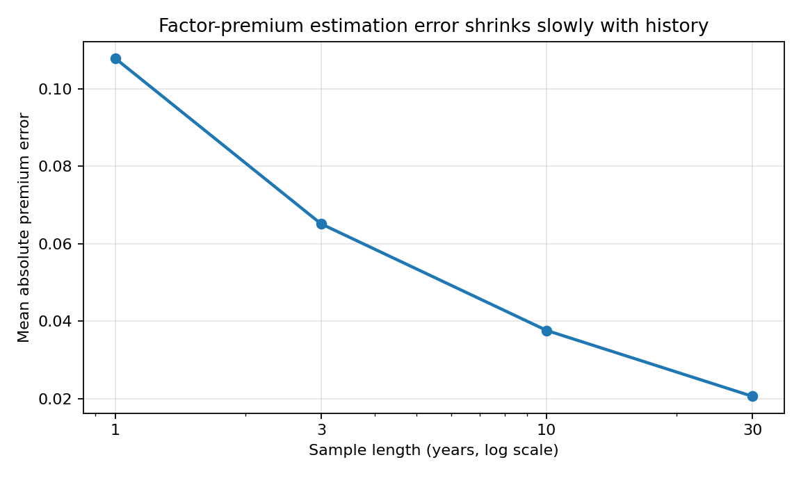
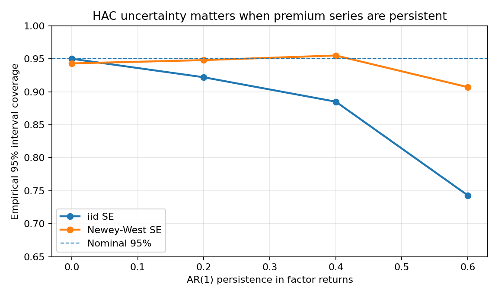
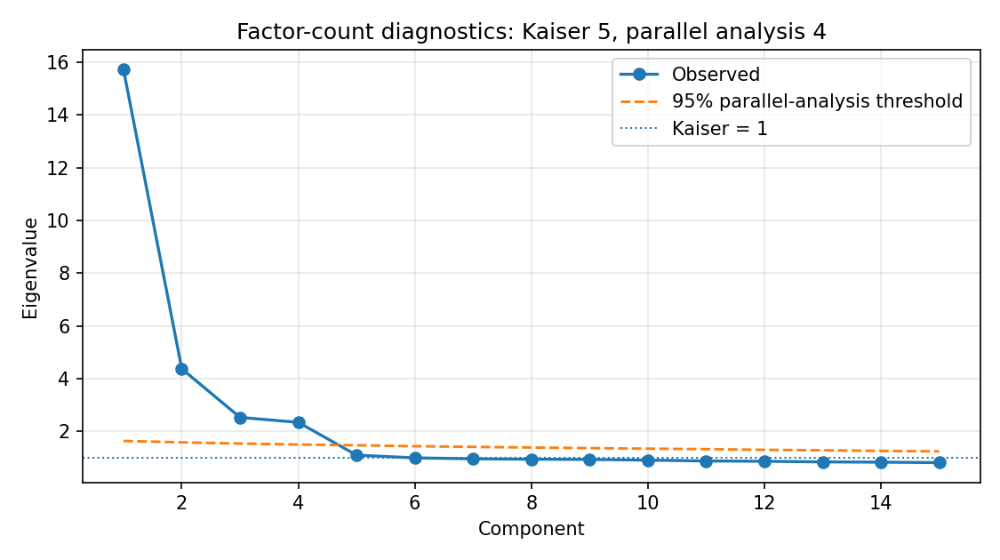
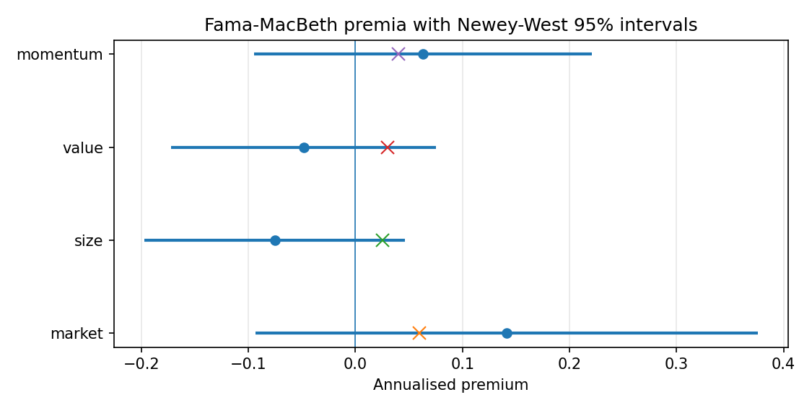

# Multifactor Risk Models

[](https://github.com/AhmadEblagh205/multifactor-risk-models/actions/workflows/ci.yml)


An independent, simulated benchmark for understanding **what a factor model can identify, how uncertain factor premia really are, and when apparently small standard errors are misleading**.

The repository builds the same synthetic equity panel three ways:

1. **Pre-specified economic factors**: time-series betas followed by Fama-MacBeth cross-sectional premium estimation.
2. **Characteristic-sorted mimicking portfolios**: market, size, value and momentum spreads built without estimating betas.
3. **Statistical latent factors**: maximum-likelihood factor analysis with factor count chosen from the data.

Because the data-generating process is known, the estimators can be scored against truth rather than judged only by in-sample fit. The project is a methodology benchmark, **not an investment strategy or track record**.

## What changed after stress-testing the project

The original version leaned too heavily on one three-year simulation. The current version treats that single world as an illustration and makes the repeated-simulation results the stronger evidence.

### 1. Three years is a weak basis for precise factor-premium claims

In the default synthetic world, the size and value sample premia can even take the wrong sign. That is not a bug in the estimator; the uncertainty intervals are wide enough to warn you that the sample is noisy.

A 100-world Monte Carlo study makes the point more cleanly:

| History | Mean absolute premium error across factors |
|---:|---:|
| 1 year | 0.108 |
| 3 years | 0.065 |
| 10 years | 0.038 |
| 30 years | 0.021 |

So moving from three to thirty years cuts the mean absolute annualised premium error by roughly two-thirds, but does not make estimation trivial.



### 2. Newey-West matters when the premium series is persistent

The simulator can add AR(1) persistence while preserving the factors' unconditional mean and volatility. Across 100 three-year worlds:

| Factor-return persistence | iid 95% coverage | Newey-West 95% coverage |
|---:|---:|---:|
| 0.0 | 0.950 | 0.943 |
| 0.2 | 0.922 | 0.948 |
| 0.4 | 0.885 | 0.955 |
| 0.6 | 0.743 | 0.907 |

At moderate persistence (`phi=0.4`), naive iid intervals cover the truth only **88.5%** of the time while Newey-West is at **95.5%**. At very strong persistence the default lag rule still under-covers, and the report shows that rather than hiding it.



### 3. Factor count is a model-selection problem

The default world contains exactly four latent factors. The textbook Kaiser rule selects **five**. Horn-style parallel analysis selects **four** by comparing the observed eigenvalues with the 95th percentile of noise-only eigenvalues.



This is a better lesson than simply plotting a scree curve: an apparently objective rule can over-extract structure, and the choice of factor-count criterion changes the model.

### 4. Latent factors recover a space, not named axes

Varimax-rotated latent factors should not be matched one-by-one to "market", "size" or "value" because rotations and sign changes are observationally equivalent. The project therefore evaluates the **subspace**.

For the four-factor default world, the canonical correlations between the estimated and true factor spaces are:

`0.980, 0.926, 0.878, 0.859`

The corresponding principal angles are about:

`11.5°, 22.1°, 28.6°, 30.8°`

That is rotation-invariant evidence that the statistical model recovers most of the true common structure without pretending that latent factor 1 has to be "the market".

### 5. Simple characteristic sorts recover factor directions surprisingly well

The tercile mimicking portfolios correlate with the true simulated factors at:

- market: **0.977**
- size: **0.832**
- value: **0.827**
- momentum: **0.897**

The factor *directions* are recovered strongly, but the three-year mean returns are much noisier. HAC uncertainty intervals are therefore reported alongside each implied premium rather than treating a short-sample mean as a stable expected return.

## Route 1 — pre-specified factors

For each asset, a time-series regression estimates its factor betas. Fama-MacBeth then reuses those exposures in a cross-sectional regression at every date and averages the resulting premium series.

The implementation reports both iid and Newey-West standard errors. The HAC errors address serial dependence in the premium series; they **do not** include a Shanken correction for first-stage beta estimation.



The equal-weight portfolio is also decomposed into Euler-style factor contributions plus full residual portfolio variance. Residual covariance is retained, so the decomposition does not silently assume idiosyncratic returns are independent.

## Route 2 — characteristic-sorted mimicking portfolios

`src/mimicking.py` forms top-minus-bottom tercile spreads on simulated size, book-to-market and momentum characteristics, with the equal-weight universe as the market portfolio. This route needs no estimated beta for construction.

Its strongest result is the contrast between **high correlation with the true factor direction** and **high uncertainty in the short-run mean premium**.

## Route 3 — statistical factor analysis

Returns are standardised, the correlation eigenvalues are inspected, and factor count is compared under:

- Kaiser eigenvalue-greater-than-one rule;
- Horn parallel analysis against random Gaussian panels.

Maximum-likelihood factor analysis with varimax rotation then extracts the selected latent space. Recovery is assessed using canonical correlations and principal angles rather than arbitrary axis matching.

## Five-factor extension

A switch adds profitability and investment factors to the same simulator. The single-world report remains available, but it is intentionally not used to claim that five premia have been "recovered" simply because one confidence interval contains the truth. The repeated-simulation study is the stronger standard of evidence.

## Usage

```bash
pip install -r requirements.txt

# Synthetic benchmark with known truth
python src/run.py
python src/mimicking.py
python src/five_factor.py

# Repeated-simulation robustness study (100 worlds per setting)
python src/robustness.py

# A real returns panel: statistical-factor route
python src/run.py --returns-csv data/raw/returns.csv

# Returns plus pre-specified factor returns: both routes where applicable
python src/run.py \
  --returns-csv data/raw/returns.csv \
  --factors-csv data/raw/factors.csv
```

CSV inputs must use a date index, numeric columns and no missing observations. Returns and factor panels are aligned on their overlapping dates.

## Outputs

- `reports/summary.json` — one synthetic world's factor estimates, uncertainty, risk decomposition and latent-space recovery.
- `reports/mimicking_summary.json` — characteristic-sort correlations and HAC premium intervals.
- `reports/five_factor.json` — the five-factor single-world diagnostic.
- `reports/robustness.json` — sample-length and HAC repeated-simulation experiments.
- `reports/figures/` — executable figures used in this README.

## Tests

`pytest` currently covers:

- beta recovery;
- vectorised Fama-MacBeth equivalence to explicit period-by-period regressions;
- truth against broad HAC uncertainty bands in a fixed synthetic world;
- Newey-West behaviour under white noise and persistent series;
- exact covariance-aware portfolio risk reconstruction;
- Kaiser versus parallel-analysis factor count;
- rotation-invariant latent-space recovery;
- mimicking-factor recovery and uncertainty output;
- five-factor extension;
- AR(1) factor simulation;
- smoke tests for both robustness studies.

CI runs on every push and pull request.

## Licence

MIT, see [LICENSE](LICENSE).
